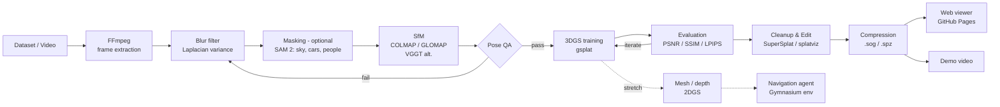
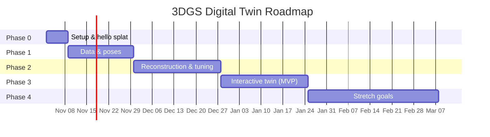

# Open-World Digital Twin with 3D Gaussian Splatting

> Multi-view video → camera poses → photoreal 3D Gaussian Splatting model → an interactive, editable digital twin you can explore in the browser (and, as a stretch goal, navigate with an AI agent).

<!-- TODO: hero GIF of the final twin goes here -->
<!-- TODO: badges (Python, PyTorch, gsplat, license) -->

**Status:** 🟡 Planning · **Started:** Nov 2026 · **Target MVP:** end of Phase 3 (~Week 11)

---

## Table of Contents
1. [What the Final Result Looks Like](#1-what-the-final-result-looks-like)
2. [Goals & Skills Demonstrated](#2-goals--skills-demonstrated)
3. [System Architecture](#3-system-architecture)
4. [Core Technical Decisions](#4-core-technical-decisions)
5. [Hardware Reality: Running on a 6 GB GPU](#5-hardware-reality-running-on-a-6-gb-gpu)
6. [Repository Layout](#6-repository-layout)
7. [Environment Setup](#7-environment-setup)
8. [Phase-by-Phase Workflow](#8-phase-by-phase-workflow)
9. [Extra Ideas & Extensions](#9-extra-ideas--extensions)
10. [Evaluation Protocol](#10-evaluation-protocol)
11. [Timeline](#11-timeline)
12. [Documentation & Portfolio Checklist](#12-documentation--portfolio-checklist)
13. [Common Pitfalls → Fixes](#13-common-pitfalls--fixes)
14. [Legal & Data Notes](#14-legal--data-notes)
15. [Definition of "Done"](#15-definition-of-done)
16. [Progress Tracker](#16-progress-tracker)
17. [References](#17-references)

---

## 1. What the Final Result Looks Like

A **2–3 minute demo video** plus a **public web link** where anyone can:

1. See the original outdoor footage.
2. Watch the sparse point cloud and camera poses build up (Structure-from-Motion).
3. Watch the 3DGS model train from blurry blobs to a photoreal scene.
4. **Fly around the reconstructed scene in the browser** and play back recorded camera paths.
5. See editing in action: floaters removed, an object isolated or recolored, an object inserted.
6. *(Stretch)* Watch an agent navigate the twin using only rendered views as input.

The repo backs this up with **metrics tables, visual comparisons, a decision log, and a failure log**.

---

## 2. Goals & Skills Demonstrated

| Area | What this project shows |
|---|---|
| Spatial computing & camera geometry | SfM, intrinsics/extrinsics, bundle adjustment, pose quality analysis |
| Modern neural rendering | 3D Gaussian Splatting training, densification, SH appearance, evaluation |
| Systems engineering | Reproducible data pipeline, GPU-constrained training, compression, web delivery |
| Interactive 3D tools | Real-time viewer, camera paths, scene editing |
| (Stretch) Embodied AI | Navigation agent trained inside a reconstructed world |

This project is deliberately different from earlier Stable Diffusion / FastAPI / EEG work. It moves into **3D vision and neural rendering**.

---

## 3. System Architecture



**Data flow per stage**

| Stage | Input | Output |
|---|---|---|
| Frame extraction | `.mp4` / image folder | `images/*.jpg` |
| Filtering & masking | images | cleaned images (+ `masks/*.png`) |
| SfM | images | `sparse/0/{cameras,images,points3D}.bin` |
| Training | images + sparse model | `point_cloud.ply`, checkpoints, logs |
| Evaluation | checkpoint + test views | `metrics.json`, render grids |
| Editing / export | `.ply` | cleaned `.ply`, compressed `.sog` / `.spz` |
| Viewing | compressed splat | web page, videos |

---

## 4. Core Technical Decisions

| Decision | Choice | Reason |
|---|---|---|
| Primary representation | **3D Gaussian Splatting** | Real-time rendering, easy editing, good for interactive twins |
| Secondary (optional) | Zip-NeRF / Nerfacto | For comparison only |
| Data source | **Public outdoor datasets first** | Legal safety and faster learning. Own/game footage only later and kept private |
| Pose estimation | **COLMAP / GLOMAP** (VGGT as modern alternative) | Reliable, well understood baseline |
| Training library | **gsplat** | Modern, memory-efficient, well maintained, has the MCMC strategy |
| Editing priority | Basic first (floaters, color, simple inserts) | Text-guided editing is a stretch goal |
| Dynamics | Mask moving objects early | Full 4D is too hard for the MVP |
| Navigation agent | Stretch only | Only after the static twin is solid |
| Training compute | **Local 6 GB GPU + free/cheap cloud GPUs** | See §5 |

Keep a running log of *why* each choice was made in `docs/decisions.md`.

---

## 5. Hardware Reality: Running on a 6 GB GPU

Development machine: **NVIDIA RTX 3050 Laptop GPU, 6 GB VRAM, Windows 11.**
Most 3DGS guides assume 16–24 GB. The project is still very doable on 6 GB:

| Problem | Fix |
|---|---|
| Out of memory at full resolution | Train at **1/4 resolution** (`images_4`, `--data_factor 4`). Use 1/8 for quick experiments |
| Gaussian count explodes during densification | gsplat **MCMC strategy** with a fixed cap (≈ 0.5–1M Gaussians) |
| Extra memory overhead | `packed=True` rasterization, keep images on CPU, SH degree warm-up |
| Slow iteration | 7k-step runs for experiments, 30k steps only for final models |
| gsplat CUDA build on Windows is painful | Run training in **WSL2 (Ubuntu) + CUDA**. COLMAP, FFmpeg and SuperSplat run fine natively on Windows |
| Full-res / comparison runs | **Kaggle** (free T4/P100, ~30 h/week), **Colab**, or **RunPod / Vast.ai** (a few dollars per run) |

**Turn this into a strength:** log peak VRAM, training time and file size for every run. "Photoreal digital twin trained on a 6 GB laptop GPU" is a strong interview talking point.

---

## 6. Repository Layout

```
3D/
├── configs/            # per-scene and per-experiment YAML configs
│   ├── scenes/         # garden.yaml, bicycle.yaml, ...
│   └── experiments/    # mcmc_cap1m.yaml, sh0.yaml, ...
├── scripts/
│   ├── extract_frames.py
│   ├── filter_blur.py
│   ├── make_masks.py         # SAM 2 (optional)
│   ├── run_colmap.py         # COLMAP / GLOMAP wrapper
│   ├── pose_qa.py            # registration %, reprojection error, plots
│   ├── train.py              # thin wrapper around gsplat trainer
│   ├── evaluate.py           # PSNR / SSIM / LPIPS + render grids
│   ├── render_path.py        # camera path → video
│   └── export.py             # .ply → .sog / .spz
├── notebooks/          # exploration, plots for the write-up
├── viewer/             # web viewer (deployed via GitHub Pages)
├── agent/              # (stretch) Gymnasium env + policies
├── results/
│   ├── metrics.csv     # one row per run
│   ├── renders/
│   └── videos/
├── docs/
│   ├── architecture.png
│   ├── decisions.md    # why each choice was made
│   ├── failures.md     # what broke and how it was fixed
│   └── report.md       # final tech report / blog draft
├── data/               # gitignored: datasets, frames, COLMAP outputs
├── environment.yml
└── README.md
```

**Rule:** every stage is **one command + one config**, so any scene can be reproduced from a clean clone.

---

## 7. Environment Setup

### 7.1 Windows side
- NVIDIA driver (recent, with WSL CUDA support)
- [COLMAP](https://colmap.github.io/) (CUDA build) and optionally [GLOMAP](https://github.com/colmap/glomap)
- [FFmpeg](https://ffmpeg.org/)
- [SuperSplat](https://superspl.at/editor) (runs in the browser, nothing to install)

### 7.2 WSL2 side (training)
```bash
# inside WSL2 Ubuntu
conda create -n gs python=3.10 -y
conda activate gs

# Pick the PyTorch build that matches your CUDA version (see pytorch.org)
pip install torch torchvision --index-url https://download.pytorch.org/whl/cu121

pip install gsplat
git clone https://github.com/nerfstudio-project/gsplat.git   # for examples/simple_trainer.py
pip install -r gsplat/examples/requirements.txt

# optional
pip install nerfstudio            # NeRF baselines (Phase 4)
```

**Pin and record versions** (driver, CUDA, PyTorch, gsplat, COLMAP) in `environment.yml` and in this README once they work. Version mismatches are the #1 time sink.

---

## 8. Phase-by-Phase Workflow

Each phase has a **goal, steps, deliverables, and exit criteria**. Don't move on until the exit criteria pass.

### Phase 0: Setup & "Hello Splat" (Week 0)

**Goal:** prove the whole toolchain works end to end before investing in quality.

Steps:
1. Install everything from §7.
2. Download the Mip-NeRF 360 dataset (`360_v2.zip`) and pick **garden**.
3. Run a short 7k-step training at 1/8 resolution.
4. Open the resulting `.ply` in SuperSplat.

Exit criteria:
- [ ] Training runs without crashing on the local GPU (or on Kaggle).
- [ ] A `.ply` opens in SuperSplat and is recognisably the scene (even if ugly).
- [ ] Versions recorded.

---

### Phase 1: Data Acquisition & Poses (Weeks 1–3)

**Goal:** reliable multi-view images plus accurate camera poses.

**Dataset order (easy → hard):**

| # | Scene | Why |
|---|---|---|
| 1 | Mip-NeRF 360 **garden** | Clean, has reference poses → validate your own COLMAP run |
| 2 | Mip-NeRF 360 **bicycle / stump / treehill / flowers** | More variety, still clean |
| 3 | One **DL3DV-10K** outdoor scene | Real-world capture, raw video |
| 4 | One **WayveScenes101** scene | Driving / open-road feel, moving objects, exposure changes |

**Steps**

1. **Extract frames** (for video sources):
   ```bash
   ffmpeg -i input.mp4 -vf fps=3 -qscale:v 2 data/<scene>/images/%05d.jpg
   ```
   2–5 fps is usually enough. Too many near-duplicate frames slow COLMAP without improving quality.

2. **Filter blurry frames:** compute the variance of the Laplacian (OpenCV) and drop the bottom ~10–15%.

3. **Run Structure-from-Motion:**
   ```bash
   colmap feature_extractor --database_path db.db --image_path images \
       --ImageReader.single_camera 1 --ImageReader.camera_model OPENCV
   colmap sequential_matcher --database_path db.db     # video; use exhaustive_matcher for unordered photos
   colmap mapper --database_path db.db --image_path images --output_path sparse
   # or, faster global SfM:
   glomap mapper --database_path db.db --image_path images --output_path sparse
   ```
   Then create downscaled copies (`images_2`, `images_4`, `images_8`) for training.

4. **Validate against ground truth:** re-run COLMAP yourself on garden and compare with the official poses (align and measure rotation/translation error). This is your first real validation result.

5. **(Optional) Masks:** use SAM 2 to mask sky, cars, people or HUD elements. Needed mainly for scenes 3–4.

**Pose QA checklist** (`scripts/pose_qa.py`):
- [ ] > 95% of images registered
- [ ] Mean reprojection error < ~1 px
- [ ] Sparse point cloud looks right when you inspect it (no doubled walls, no broken-off chunks)
- [ ] Camera trajectory is smooth (for video)

**Deliverables:** frame extraction, blur filter and COLMAP scripts; pose QA report with screenshots; `docs/failures.md` entries.

---

### Phase 2: High-Quality Static Reconstruction (Weeks 4–7)

**Goal:** photorealistic, navigable 3DGS model.

**Steps**

1. **Baseline run** on garden at 1/4 resolution:
   ```bash
   cd gsplat/examples
   python simple_trainer.py default --data_dir ../../data/360_v2/garden \
       --data_factor 4 --result_dir ../../results/garden_default
   ```
2. **Memory-capped run** (MCMC strategy):
   ```bash
   python simple_trainer.py mcmc --data_dir ../../data/360_v2/garden \
       --data_factor 4 --result_dir ../../results/garden_mcmc
   # cap the Gaussian count via the strategy options (check: python simple_trainer.py mcmc --help)
   ```
3. **Experiment matrix:** change one factor at a time and log everything to `results/metrics.csv`:

   | Factor | Values to try |
   |---|---|
   | Strategy | default (ADC) vs MCMC |
   | Gaussian cap | 300k / 500k / 1M |
   | SH degree | 0 vs 3 |
   | Resolution | 1/8 vs 1/4 (vs 1/2 on cloud) |
   | Densification threshold | default vs ±50% |
   | Appearance handling | off vs appearance embeddings / bilateral grid |
   | Steps | 7k vs 30k |

4. **Evaluate:** PSNR / SSIM / LPIPS on held-out views, plus a visual check for floaters, holes, blur, and needle-shaped Gaussians.
5. **Target:** within ~1 dB PSNR of the published 3DGS results for the same scene and resolution.
6. **Move to harder scenes** (DL3DV, Wayve). Expect sky floaters, ghosting from moving cars and exposure flicker. Fix them with masks and appearance modelling, and document each fix.

**Deliverables:** metrics table; side-by-side renders (ground truth | render | error map); training progress GIF; failure log.

Exit criteria:
- [ ] Novel views look close to the real images on at least 2 scenes
- [ ] Metrics table filled in
- [ ] Model loads in a viewer

---

### Phase 3: Interactive Digital Twin (MVP) (Weeks 8–11)

**Goal:** free exploration plus basic editing, available to anyone.

**Steps**

1. **Cleanup in SuperSplat:** select and delete floaters, crop to the scene bounds, remove low-opacity junk.
2. **Basic edits:**
   - isolate an object (e.g. a table or tree) and export it separately
   - change the color or opacity of a selection
   - insert a simple object (another splat or a primitive) into the scene
3. **Code-based editing (splatviz / Python):** write small scripts that filter Gaussians by opacity, scale or bounding box. This shows you understand the representation, not just the GUI.
4. **Camera paths:** record keyframes, interpolate them smoothly, render to video (`scripts/render_path.py`).
5. **Compression & web delivery:** export to `.sog` / `.spz` and host on **GitHub Pages** with a web viewer (SuperSplat/PlayCanvas viewer or a Three.js-based splat viewer). Test on an ordinary laptop.
6. **Demo video (most important for interviews):**
   footage → COLMAP point cloud → training timelapse → free flight → editing → metrics overlay.

Exit criteria (**MVP**):
- [ ] A stranger can open the link and fly around smoothly
- [ ] Obvious artifacts are cleaned
- [ ] Demo video published
- [ ] README updated with GIFs, metrics and the link

---

### Phase 4: Stretch Goals (Week 12+)

Only start after the MVP passes. Ordered by portfolio value relative to effort:

1. **Pose estimation comparison:** VGGT (feed-forward) vs COLMAP/GLOMAP on the same scenes. Compare speed, pose error and final PSNR.
2. **Geometry for the twin:** extract depth and mesh using **2DGS** (or PGSR). This gives collision geometry for navigation and measurements.
3. **Semantic twin:** lift SAM/CLIP features into the Gaussians (Feature-3DGS / LangSplat style) so you can click an object, or type "bench", to select it.
4. **Navigation agent:**
   - Wrap the gsplat renderer as a **Gymnasium** environment (observation = rendered RGB(-D), action = move/turn).
   - Use the 2DGS mesh for collisions.
   - Start with **imitation learning from recorded camera paths**, then try RL (PPO) for goal reaching.
5. **Better dynamics:** robust masking of moving objects in driving scenes, and comparison with a 4DGS method.
6. **NeRF comparison:** Zip-NeRF / Nerfacto through nerfstudio. Compare quality, training time, render FPS and size.
7. **Compression study:** plot file size vs PSNR (quantisation, SH pruning, Gaussian count).
8. **Scale up:** connect multiple regions, mild lighting or weather variations.

---

## 9. Extra Ideas & Extensions

Additions beyond the original plan:

- **Phase 0 smoke test:** catches setup problems before they eat Week 1.
- **Ground-truth pose validation** on garden before trusting your own captures.
- **6 GB-aware design** plus a cloud GPU fallback (§5).
- **A web-hosted twin**, not just local viewers. Reviewers click links; they don't install tools.
- **Geometry and semantics:** turn a pretty splat into a real digital twin an agent can use.
- **Reproducibility:** configs, fixed seeds, TensorBoard / W&B logging, one command per stage.
- **Failure-first documentation:** a good `failures.md` impresses more than perfect results.
- **Write-up:** a blog post or short tech report (`docs/report.md`) at the end roughly doubles the portfolio value.
- **Your own capture (later, private):** walk around a campus spot with a phone (slow, steady, overlapping) and reconstruct it. This shows you can handle real capture, not just curated datasets.

---

## 10. Evaluation Protocol

- **Train/test split:** hold out every 8th image (the standard Mip-NeRF 360 protocol).
- **Metrics:** PSNR ↑, SSIM ↑, LPIPS (VGG) ↓ on held-out views.
- **System metrics:** #Gaussians, training time, peak VRAM, render FPS, file size (raw `.ply` and compressed).
- **Qualitative:** fixed set of render grids (GT | render | error) for every final model.

**Results table template** (`results/metrics.csv` → rendered here):

| Scene | Res | Strategy | #Gaussians | Steps | PSNR | SSIM | LPIPS | Train time | Peak VRAM | Size (raw / comp.) |
|---|---|---|---|---|---|---|---|---|---|---|
| garden | 1/4 | default | – | 30k | – | – | – | – | – | – |
| garden | 1/4 | mcmc 1M | – | 30k | – | – | – | – | – | – |
| bicycle | 1/4 | mcmc 1M | – | 30k | – | – | – | – | – | – |

---

## 11. Timeline

Part-time, roughly 10–12 h/week.

| Week | Phase | Focus | Milestone |
|---|---|---|---|
| 0 | 0 | Environment, WSL2, hello splat | Toolchain works |
| 1 | 1 | Mip-NeRF 360 download, COLMAP on garden | First sparse model |
| 2 | 1 | Pose QA script, GT pose comparison | Pose QA report |
| 3 | 1 | DL3DV / Wayve frames, blur filter, masks | 4 scenes with poses |
| 4 | 2 | Baseline gsplat training | First real splat |
| 5 | 2 | Experiment matrix (strategy, cap, SH) | metrics.csv populated |
| 6 | 2 | Evaluation scripts, render grids | Comparison figures |
| 7 | 2 | Hard scenes, appearance handling | Final static models |
| 8 | 3 | SuperSplat cleanup & editing | Clean `.ply` |
| 9 | 3 | Code-based editing, camera paths | Path videos |
| 10 | 3 | Compression + web viewer | Public link |
| 11 | 3 | Demo video + README polish | **MVP** |
| 12+ | 4 | Stretch goals | Extended results + write-up |



---

## 12. Documentation & Portfolio Checklist

- [ ] Architecture diagram (`docs/architecture.png` + Mermaid above)
- [ ] Capture and processing decisions (`docs/decisions.md`)
- [ ] Quantitative metrics table
- [ ] Visual comparisons (GT vs render, before/after cleanup)
- [ ] Failure cases and fixes (`docs/failures.md`)
- [ ] Training timelapse GIF
- [ ] **Demo video** (2–3 min)
- [ ] Public web viewer link
- [ ] Tech report / blog post
- [ ] A clean README hero section (GIF + one-line pitch + link)

---

## 13. Common Pitfalls → Fixes

| Pitfall | Fix |
|---|---|
| Starting with chaotic game footage or commercial game assets publicly | Public datasets first. Game footage stays private |
| Trying full 4D dynamics or text-guided editing too early | Mask dynamics. Advanced editing is Phase 4 |
| Ignoring pose quality (bad poses = bad reconstruction) | Pose QA checklist before every training run |
| Scenes too large for the GPU | 1/4 resolution, MCMC cap, cloud for full-res |
| Skipping visual checks of intermediate results | Screenshot every stage, and stop at the first bad stage |
| CUDA / PyTorch / gsplat version mismatch | Pin versions in Phase 0 and record them |
| COLMAP fails on sky or textureless regions | Mask the sky, sequential matching for video, try GLOMAP |
| Auto-exposure flicker between frames | Appearance embeddings / bilateral grid |
| Floaters near cameras or in the sky | Masks, opacity regularisation, SuperSplat cleanup |
| Near-duplicate frames slowing SfM | Lower the fps (2–5) and drop blurry frames |
| Scope creep | No Phase 4 work until the MVP link works |

---

## 14. Legal & Data Notes

- Check and cite the license of every dataset (Mip-NeRF 360, DL3DV-10K, WayveScenes101). Some are non-commercial or research-only.
- Don't redistribute raw datasets in this repo. Link to the official sources.
- Footage from commercial games stays **private**. Don't publish reconstructions of copyrighted game assets.
- For your own captures, avoid identifiable people or blur them.

---

## 15. Definition of "Done"

The project counts as complete when:

- [ ] ≥ 3 scenes reconstructed, with metrics in a table
- [ ] A public web viewer link that runs smoothly on an ordinary laptop
- [ ] A demo video: footage → poses → training → exploration → editing
- [ ] Architecture diagram, decision log, failure log
- [ ] At least one stretch goal with a quantitative result
- [ ] Any scene reproducible from a clean clone with one command per stage

---

## 16. Progress Tracker

**Phase 0: Setup**
- [ ] WSL2 + CUDA + PyTorch + gsplat installed
- [ ] COLMAP / GLOMAP / FFmpeg installed
- [ ] Hello-splat run completed
- [ ] Versions pinned

**Phase 1: Data & Poses**
- [ ] Mip-NeRF 360 downloaded
- [ ] COLMAP on garden + GT pose comparison
- [ ] Frame extraction + blur filter scripts
- [ ] DL3DV and Wayve scenes posed
- [ ] Pose QA report

**Phase 2: Reconstruction**
- [ ] Baseline garden model
- [ ] Experiment matrix completed
- [ ] Evaluation script + render grids
- [ ] Hard scenes reconstructed

**Phase 3: Interactive Twin**
- [ ] SuperSplat cleanup + edits
- [ ] Code-based editing scripts
- [ ] Camera path videos
- [ ] Compressed web viewer live
- [ ] Demo video
- [ ] **MVP**

**Phase 4: Stretch**
- [ ] VGGT vs COLMAP
- [ ] 2DGS geometry
- [ ] Semantic twin
- [ ] Navigation agent
- [ ] Write-up published

---

## 17. References

**Core**
- Kerbl et al., *3D Gaussian Splatting for Real-Time Radiance Field Rendering*, SIGGRAPH 2023. [repo](https://github.com/graphdeco-inria/gaussian-splatting)
- *gsplat*: [github.com/nerfstudio-project/gsplat](https://github.com/nerfstudio-project/gsplat)
- Kheradmand et al., *3D Gaussian Splatting as Markov Chain Monte Carlo*, 2024 (MCMC strategy)

**Poses**
- Schönberger & Frahm, *Structure-from-Motion Revisited* (COLMAP), CVPR 2016. [colmap.github.io](https://colmap.github.io/)
- Pan et al., *Global Structure-from-Motion Revisited* (GLOMAP), ECCV 2024. [repo](https://github.com/colmap/glomap)
- Wang et al., *VGGT: Visual Geometry Grounded Transformer*, CVPR 2025. [repo](https://github.com/facebookresearch/vggt)

**Datasets**
- Barron et al., *Mip-NeRF 360*, CVPR 2022. [project page](https://jonbarron.info/mipnerf360/)
- Ling et al., *DL3DV-10K*, CVPR 2024. [project page](https://dl3dv-10k.github.io/DL3DV-10K/)
- Zürn et al., *WayveScenes101*, 2024. [repo](https://github.com/wayveai/wayve_scenes)

**Viewing & editing**
- SuperSplat: [superspl.at/editor](https://superspl.at/editor)
- splatviz: [github.com/Florian-Barthel/splatviz](https://github.com/Florian-Barthel/splatviz)

**Stretch**
- Huang et al., *2D Gaussian Splatting*, SIGGRAPH 2024
- Ravi et al., *SAM 2: Segment Anything in Images and Videos*, 2024
- Qin et al., *LangSplat*, CVPR 2024 · Zhou et al., *Feature 3DGS*, CVPR 2024
- Barron et al., *Zip-NeRF*, ICCV 2023 · *nerfstudio*: [nerf.studio](https://docs.nerf.studio/)

---

*This README is the project's living roadmap. Update the progress tracker and results table as work goes on.*
